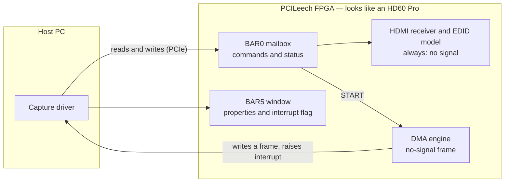

# PCILeech HD60 Pro (MZ0380) emulation

FPGA firmware that makes a PCILeech card look like an **Elgato Game Capture
HD60 Pro** (YUAN MZ0380) video capture card with **no input signal**.

To the host PC, the board enumerates as a real HD60 Pro and answers the
capture driver's commands. There is no HDMI input — the card always reports
"no signal" and, on start, sends one grey "NO SIGNAL" frame.

The project lives in [`pcileech-hd60pro/`](pcileech-hd60pro/).

## How it works



1. The host driver loads and talks to the card through the **BAR0 mailbox**:
   init, get board version, set buffers, start/stop, GPIO, and I2C.
2. The **receiver model** answers like an HDMI chip with nothing plugged in.
3. On **start**, the **DMA engine** writes one "no signal" frame into the
   host's memory and raises an interrupt, matching the real card's behaviour.

## Supported boards

| Board | FPGA | Pick in the wizard |
|---|---|---|
| PCIeSquirrel | Artix-7 XC7A35T | `squirrel` |
| Enigma-X1 | Artix-7 XC7A75T | `enigma_x1` |
| Captain 75T | Artix-7 XC7A75T | `captain_75T` |
| Screamer M2 | Artix-7 XC7A35T | `m2` |

## Device identity

| Field | Value |
|---|---|
| Vendor / Device | `12AB:0381` |
| Subsystem | `1CFA:0010` |
| Class | `048000` (multimedia video) |
| Revision | `01` |

On Linux you can confirm it with `lspci -nn -d 12ab:0381`.

## Build the bitstream

You need **Xilinx Vivado 2023.2 or later** on Windows.

1. Open a command prompt in [`pcileech-hd60pro/`](pcileech-hd60pro/).
2. Run the wizard and pick your board:

   ```bat
   generate.bat
   ```

   It finds Vivado (from `%VIVADO%`, `PATH`, or `C:\`/`D:\Xilinx\Vivado\*`)
   and creates the project. You can also pass the board directly, e.g.
   `generate.bat squirrel`.
3. Open the generated `pcileech_<board>.xpr`, or run
   `source vivado_build.tcl`, to build the bitstream. This can take ~1 hour.
4. Flash the `.bin` to your board.

More detail, including how to change the device ID and serial number, is in
[`pcileech-hd60pro/build.md`](pcileech-hd60pro/build.md).

## Develop and test

You do not need Vivado or a board to exercise the behavioural RTL:

- **Simulation** — `pcileech-hd60pro/.claude/skills/run-pcileech-hd60pro/`
  drives the DMA engine and mailbox through their real interfaces with
  Verilator. Run it with `bash .claude/skills/run-pcileech-hd60pro/drive.sh`.
- **Static checks** — `tools/lint.py` (pyslang elaboration) and
  `tools/check_wiring.py` (module wiring).

## How the emulation is designed

The full design — register map, interrupt flow, DMA frame geometry, and which
commands are modelled — is in
[`pcileech-hd60pro/HD60PRO_DESIGN.md`](pcileech-hd60pro/HD60PRO_DESIGN.md).

## Credits and scope

Built on [PCILeech FPGA](https://github.com/ufrisk/pcileech-fpga). The HD60 Pro
register map and behaviour were reverse-engineered by the Wolffyx
`hd60pro-linux-driver` project.

This is for research and learning about PCIe device emulation. It does not
capture real HDMI video — that lives on the card's own processor and is not
reproduced here.
